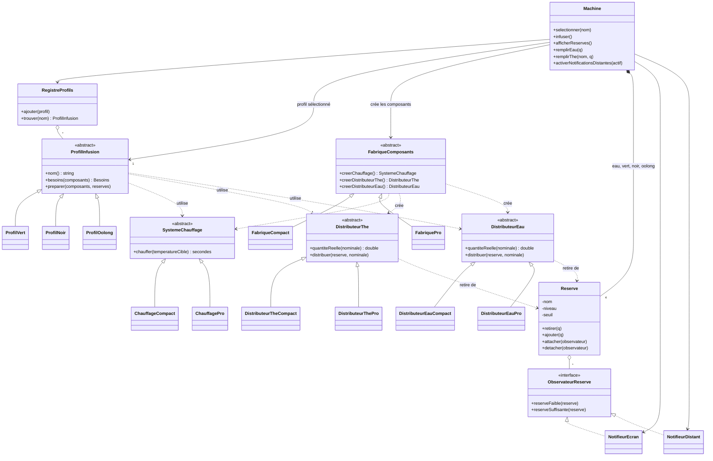

# PolyInfusion — Diagramme de classes (TP2a)

Patrons : **Strategy** (profils), **Abstract Factory** (composants), **Observer** (réserves et alertes).

## Valeurs propres à chaque classe concrète

| Classe | Valeur |
|---|---|
| `ChauffageCompact` / `ChauffagePro` | 5 °C/s / 10 °C/s (départ à 20 °C) |
| `DistributeurTheCompact` / `Pro` | facteur 1,10 / 1,00 |
| `DistributeurEauCompact` / `Pro` | facteur 1,20 / 1,00 |
| `ProfilVert` | 5 g, 250 mL, 80 °C, infusion directe 120 s |
| `ProfilNoir` | 5 g, 250 mL, 95 °C, infusion directe 180 s |
| `ProfilOolong` | 5 g, 250 mL, 90 °C, rinçage 50 mL puis infusion 90 s |
| `Reserve` eau / thé | seuil 500 mL / 10 g, départ 2000 mL / 20 g |
